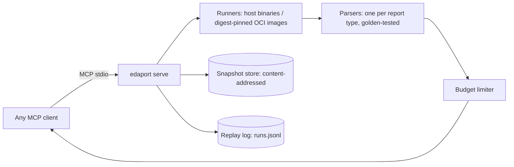

# EDAPort

Typed, size-bounded, replayable MCP tools for open-source EDA agents.

An agent driving Yosys/OpenROAD through a shell drowns in megabyte logs, misparses free-text reports and
cannot cheaply undo a bad move. EDAPort sits between the agent and the tools:

- **Typed results.** Every tool returns JSON validated against a pydantic schema (`edaport/models.py`),
  not text to be scraped.
- **Bounded.** Responses default to about 2,000 tokens. If a result is cut, it says so: `truncated: true`,
  `omitted: {"paths": 12}`, and a `more_handle` for `result_page`. `log_page` greps the raw log, so nothing
  is ever silently dropped.
- **Snapshots.** Design state is content-addressed (`design_ref = sha256(manifest)`). Tools that change the
  design return a new ref. Old refs stay valid, so branching and rollback cost nothing.
- **Replay.** Each call goes into an append-only JSONL log with its inputs, tool identity (image digest),
  seed, threads, CPU/wall time and a digest of the result. `edaport replay r-0007` runs the call again and
  compares the digests.



## Quick start

```bash
make install              # pip install -e ".[test]"; needs yosys, iverilog, verilator, sby+z3, klayout, netgen
make demo                 # MCP client <-> server over stdio: lint, sim, formal, fix on a branch, synth, equiv, replay
make orfs-image && make demo-orfs   # + gcd/sky130hd through ORFS stages and OpenSTA (docker)
make test                 # golden parser tests + live tool integration (+ ORFS tests if the image is present)
make eval-ab              # A/B observation-cost eval and determinism rate
```

Use it from an MCP client (Claude Code example):

```bash
claude mcp add edaport -e EDAPORT_HOME=$PWD/.edaport -e EDAPORT_IMPORT_ROOTS=$PWD -- edaport serve
```

CLI over the same engine: `edaport import DIR --label main`, `edaport call lint_run '{"design_ref":"main"}'`,
`edaport runs`, `edaport log r-0003 --pattern Error`, `edaport replay r-0003`, `edaport branches`, `edaport gc`.

## Agent demo without an LLM (`make agent-demo`, `make agent-demo-orfs`)

`examples/agent_demo.py` is a scripted, rule-based agent that drives the MCP server over stdio and decides
only from typed results. No API key is needed. Output of a real run (2026-11-11):

- **Repair loop.** `sim_run` fails at 116 ns. The agent writes 10 one-operator patches, each to its own
  branch. 5 pass simulation, 3 of those also pass a formal proof, and coverage breaks the tie:
  `(count > MAX) -> (count >= MAX)`. It then signs off with synthesis, equivalence and replay.
- **Timing-closure loop.** gcd on sky130hd misses its 1.1 ns clock (WNS -1790 ps at floorplan). The agent
  relaxes the clock by the slack deficit plus 5%, re-runs synth through route on a branch, and checks with
  OpenSTA: closed at 2.98 ns with post-route WNS +28 ps and 0 DRC errors. 49 tool calls in total.

Limits: the candidates come from a fixed rule (swap one comparison operator), and timing is closed only by
relaxing the clock, not by improving the design. An LLM would replace the candidate generator; the tool
loop stays the same. CI runs the repair loop and puts the transcript in the job summary.

## Tools (v1)

The spec name `lint.run` becomes the MCP name `lint_run`. Several clients, the Anthropic API among them,
only accept tool names that match `^[a-zA-Z0-9_-]{1,64}$`.

| tool | backend | returns |
|---|---|---|
| `lint_run` | Verilator `--lint-only -Wall` / `iverilog -t null` | `errors[]`, `warnings[]` `{file,line,code,msg}`, `warnings_grouped` |
| `synth_run` | Yosys `synth` (+ `dfflibmap`/`abc` with a liberty) | `cells`, `cell_types`, `area_um2`, `logic_depth`, `netlist_ref`, new `design_ref` |
| `sim_run` | Icarus or Verilator (`coverage=true` writes `coverage.dat`) | `status`, `tests[]`, `first_failure.signal_window` (VCD changes around the failure), `coverage` |
| `formal_run` | SymbiYosys (`mode`/`depth` override the .sby) | `status`, `failed_props[] {name,step,location,trace_ref}` |
| `equiv_run` | Yosys `equiv_make/simple/induct` | `equivalent`, `proven/total`, `unproven[]` |
| `flow_run_stage` | ORFS `make <stage>` in the pinned image | curated QoR `metrics`, `units`, `warnings_grouped`, new `design_ref` |
| `sta_report_paths` | OpenSTA `report_checks -format json` | `wns_ps`, `tns_ps`, `paths[] {slack_ps,start,end,clock,stages[]}` |
| `drc_run` | KLayout batch DRC (`.lyrdb`) | `violations[] {rule,layer,bbox_um,count}`, `total` |
| `lvs_run` | Netgen (`-json`) | `match`, `mismatches[]` |
| `snapshot_import/read/write/branch/restore/diff` | store | refs, listings, file windows, file + metric deltas |
| `log_page`, `result_page` | store | raw-log grep/paging; full text of trimmed fields |
| `replay_run` | replay log | `match`, both digests, `output_ref_match` |

Testbench convention for `sim_run`: print `TEST <name> PASS|FAIL @<time_ns> <msg>`. `$error`, `$fatal` and
assertion messages also count as failures. A run that never reaches `$finish` is reported as `error`.

**Write scope.** Agents edit with `snapshot_write`. Paths are checked: no absolute paths, no `..`, at most
1 MiB. `build/` and `orfs/` belong to the tools: only tool outputs go there, and each tool captures only its
declared output directory into the new snapshot. `snapshot_import` reads only under `EDAPORT_IMPORT_ROOTS`.
ORFS overrides must match `^[A-Z][A-Z0-9_]*$` and a conservative value charset. Containers run with
`--network=none`. There is no Tcl passthrough (the spec suggests leaving it off by default).

**Security model: read this before you run it.** Many design files are code: testbenches (Verilator
supports `$system`), KLayout DRC decks (Ruby), `.sby` scripts, and Netgen setup files (Tcl). EDAPort executes
them. Each runner treats them differently:

| runner | what runs | isolation |
|---|---|---|
| `EDAPORT_RUNNER=docker` | oss-tools image | `--network=none`, only the scratch directory is mounted, runs as the calling uid |
| `EDAPORT_RUNNER=local` (dev default) | host binaries | your user privileges, with only rlimits and a timeout |

Use `local` only with agents and designs you trust.

Snapshot paths are restricted to `[A-Za-z0-9_.+@-]` and must start with `[A-Za-z0-9_]`. They are spliced
into Yosys scripts and tool argv, and Yosys `!` runs a shell command, so this restriction blocks command
injection.

`snapshot_import` skips hidden files such as `.env` and `.git`. It refuses every directory until
`EDAPORT_IMPORT_ROOTS` is set.

## Layout

```
edaport/server/    engine.py (pipeline + tools), mcp_server.py (MCP surface), budget.py (size contract)
edaport/runners/   local subprocess (rlimits, process-group kill) and digest-pinned docker runner
edaport/parsers/   one module per report type; goldens in tests/fixtures/golden (UPDATE_GOLDEN=1 to regen)
edaport/snapshot/  content-addressed store, branches, diff, gc
edaport/replay/    append-only JSONL log with flock'd sequential run ids
images/            images.lock.json (pinned digests), oss-tools/Dockerfile (pinned base, apt versions, sby commit)
evals/ab_interface/  observation-cost A/B + determinism
examples/          counter (RTL bug + tb + formal + demo liberty), gcd_sky130hd (ORFS), physical (DRC/LVS)
```

## A/B eval: observation cost (`make eval-ab`, this repo, 2026-11-09)

Each step runs the same tool once. The table compares the raw output a shell agent would read (A0) with the
typed response (A1), and checks that A1 still holds the answer. Afterwards every run is replayed.

| task | tool | A0 raw-log tokens | A1 EDAPort tokens | A1/A0 | answer in A1 | truncated |
|---|---|---:|---:|---:|:-:|:-:|
| find lint issue | `lint_run` | 134 | 116 | 86.6% | yes |  |
| localize sim failure | `sim_run` | 69 | 415 | 601.4% | yes |  |
| localize sim failure (verilator) | `sim_run` | 998 | 355 | 35.6% | yes |  |
| formal counterexample | `formal_run` | 1,073 | 128 | 11.9% | yes |  |
| prove fix | `formal_run` | 1,144 | 87 | 7.6% | yes |  |
| area + depth | `synth_run` | 6,295 | 158 | 2.5% | yes |  |
| equivalence | `equiv_run` | 4,767 | 86 | 1.8% | yes |  |
| DRC triage | `drc_run` | 20 | 130 | 650.0% | yes |  |
| LVS triage | `lvs_run` | 260 | 118 | 45.4% | yes |  |
| gcd synth QoR | `flow_run_stage` | 5,235 | 160 | 3.1% | yes |  |
| gcd floorplan QoR | `flow_run_stage` | 11,127 | 295 | 2.7% | yes |  |
| gcd place QoR | `flow_run_stage` | 18,807 | 748 | 4.0% | yes |  |
| gcd cts QoR | `flow_run_stage` | 28,959 | 301 | 1.0% | yes |  |
| gcd grt QoR | `flow_run_stage` | 40,647 | 375 | 0.9% | yes |  |
| gcd route QoR | `flow_run_stage` | 44,334 | 177 | 0.4% | yes |  |
| gcd worst paths | `sta_report_paths` | 48,130 | 891 | 1.9% | yes | yes |
| **total** | | **211,999** | **4,540** | **2.1%** | 16/16 | |

Observation tokens: A1 uses 97.9% fewer than A0 over 16 steps.  
Determinism: 16/16 replays matched (100%), single-threaded.

Read this result critically:

- On tiny logs (Icarus sim, DRC) the typed result is **larger** than the raw output. The signal window and
  the structure cost tokens. The savings come from large logs (synthesis, ORFS, STA).
- A0 counts only stdout. The DRC markers live in a `.lyrdb` file that an A0 agent would also have to read.
- This measures what an agent has to *read*, not how often it *solves* a task. The arm with an LLM in the
  loop (solve rate, tokens per solved task on CVDP plus ORFS "close timing" tasks) is milestone M3 and
  **has not been run**. The spec's success criterion (A1 ≥ A0 on solve rate, ≥30% fewer tokens per solve) is
  therefore still open.

## Status against the spec milestones

| | item | state |
|---|---|---|
| M0 | lint, synth, sim; snapshot store; replay log; CI on tiny designs | done |
| M1 | STA, flow stages, ORFS integration, DRC | done (ORFS/STA tested on gcd sky130hd, pinned image) |
| M2 | formal, equiv, LVS; size limiter; log.page | done |
| M3 | LLM A/B eval with solve rate | not done: only the observation-cost arm exists |
| G5 | pinned containers | ORFS pinned by digest. The oss-tools image built locally from the pinned Dockerfile, and every tool test passes inside it (`EDAPORT_RUNNER=docker EDAPORT_OSS_IMAGE=<image id>`). It is **not published to a registry yet**, so its lock digest is still a placeholder. The default is the host binaries (`EDAPORT_RUNNER=local`), whose identity is the hash of each tool's version banner. |

Known gaps:

- S3 snapshot backend is not implemented.
- `sta.fanout` is always null: OpenSTA's JSON output has no fanout.
- STA covers setup only and keeps the delay precision of the JSON (about 10 ps).
- `output_ref` of ORFS stages is not deterministic, because ORFS logs contain runtimes. Replay compares the
  typed result digest, which leaves out runtime and memory metrics.
- ORFS images run as the calling uid with `HOME=/tmp`.
- Replay-log lookup is a linear scan.
